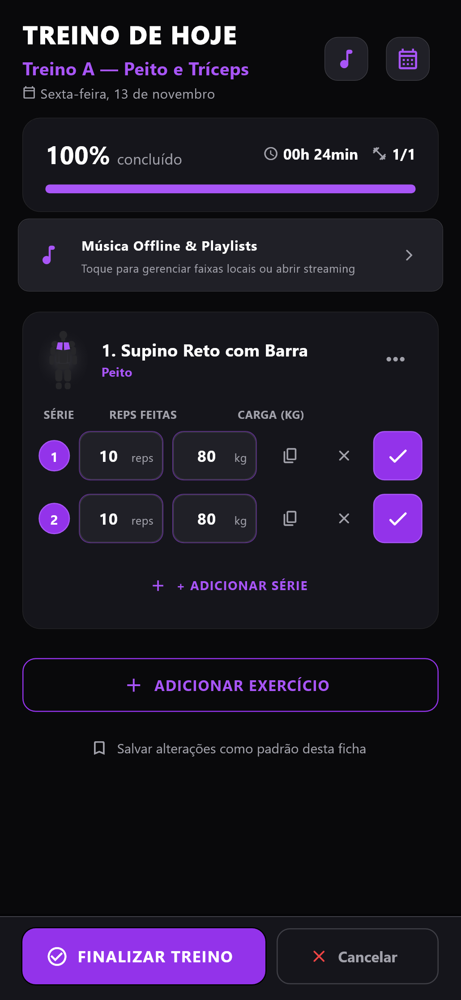
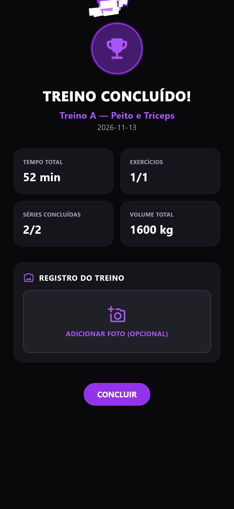
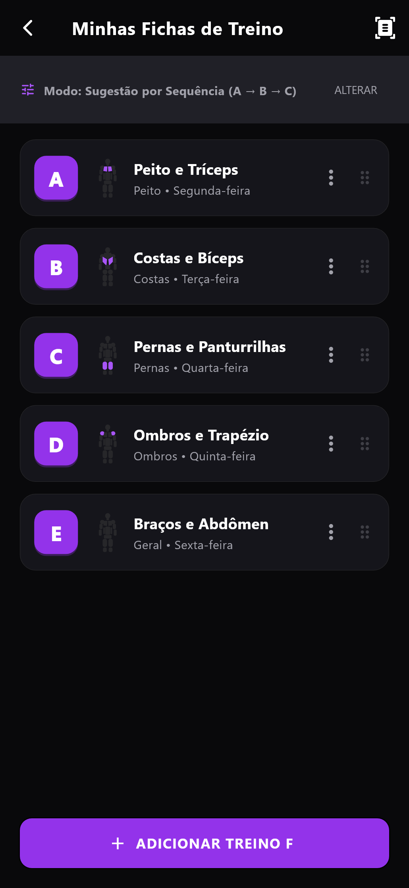
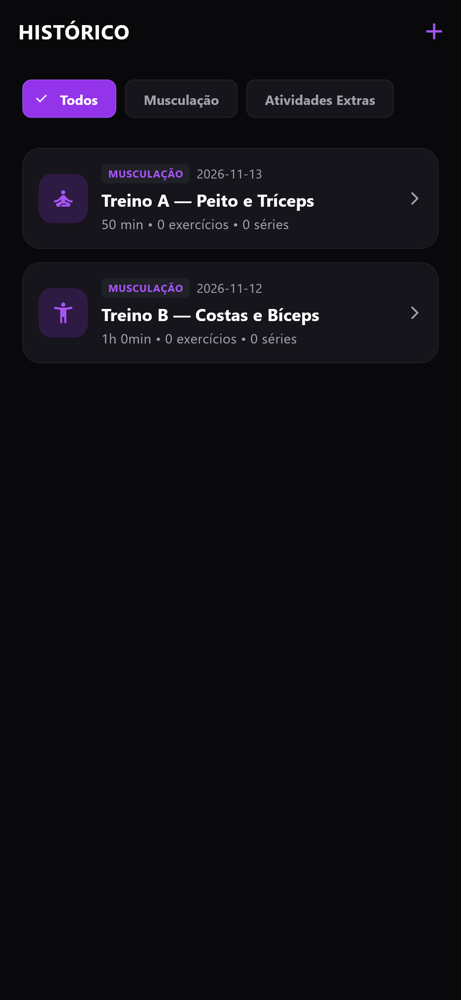
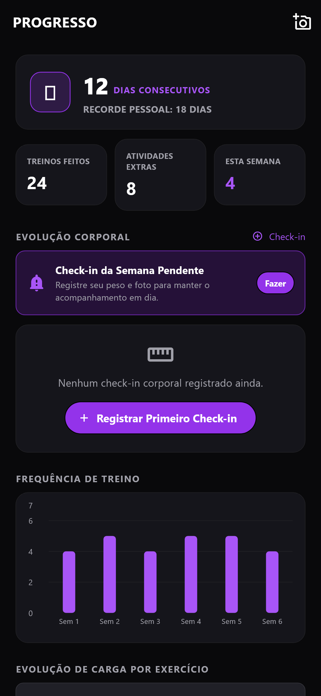
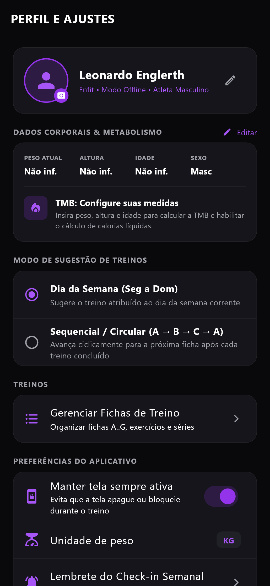
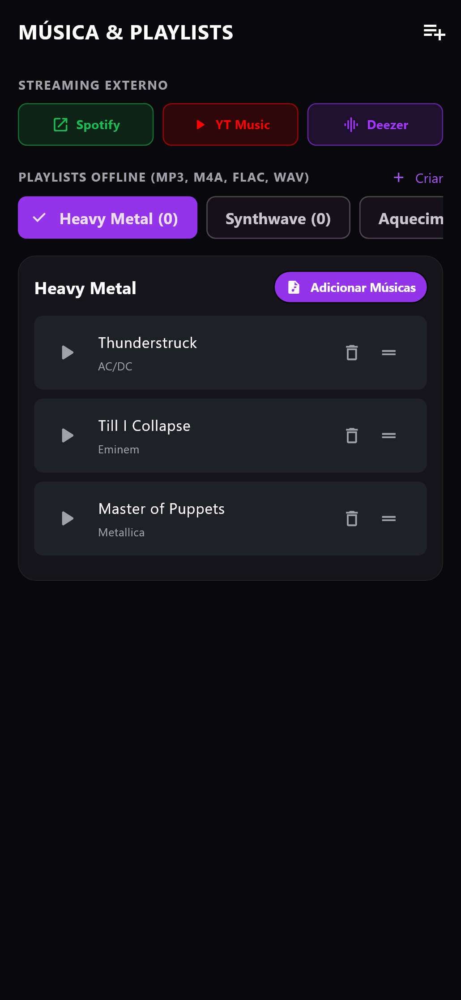

# Enfit — Acompanhamento de Musculação & Fitness

<p align="center">
  
</p>

<p align="center">
  <strong>Aplicativo Android pessoal de acompanhamento de musculação e performance física, projetado com interface premium Dark Fitness, funcionamento 100% offline, persistência durável em SQLite e arquitetura focada em privacidade absoluta.</strong>
</p>

<p align="center">
  
  
  
  
</p>

---

> 🚧 **Aviso de Vitrine Pública:**  
> Este repositório é uma vitrine técnica e visual oficial do aplicativo **Enfit**. Ele foi criado exclusivamente para apresentar a proposta, a experiência de uso, as capturas reais das telas, as tecnologias empregadas e as decisões de engenharia do projeto. O código-fonte reside em repositório privado de desenvolvimento contínuo.

---

## 🎯 Objetivo do Aplicativo

O **Enfit** foi concebido para resolver os maiores incômodos dos aplicativos de treino convencionais: interfaces poluídas, lentidão no ambiente de academia, dependência constante de conexão à internet, assinaturas recorrentes, login invasivo e perda de dados em caso de instabilidade de rede.

Sua proposta é fornecer uma experiência fluida, ágil e focada:
- **Zero Internet**: Opera com 100% das suas funcionalidades sem nenhuma conexão de rede. Nenhuma permissão de internet é solicitada no sistema.
- **Dark Fitness Premium**: Interface ergonômica com fundo preto dominante (`#09090B`), cartões escuros com elevação visual sutil (`#15151B`) e acentos pontuais em roxo (`#9333EA` / `#A855F7`), maximizando o contraste em telas AMOLED e economizando energia.
- **Agilidade Máxima no Treino**: Alvos de toque generosos, teclado numérico nativo automático ao focar em peso ou repetições, suporte a decimais para anilhas fracionadas e salvamento imediato a cada caractere digitado.
- **Snapshots Imutáveis**: O histórico de treinos passados é inviolável — alterar ou excluir uma ficha de treino hoje jamais afeta os registros, cargas e repetições já realizados no passado.

---

## 📸 Galeria Visual

Todas as capturas abaixo foram geradas a partir da aplicação real em funcionamento:

| 01. Treino Ativo | 02. Conclusão & Conquista | 03. Gestão de Fichas |
| :---: | :---: | :---: |
|  |  |  |
| Execução com cronômetro persistente, progresso real, tabela de séries e silhueta anatômica | Celebração com confetes, resumo de volume de carga, séries e anexo de foto | Organização de fichas A/B/C/D/E, dias da semana e grupos musculares |

| 04. Histórico Unificado | 05. Progresso & Gráficos | 06. Perfil & Backup |
| :---: | :---: | :---: |
|  |  |  |
| Feed cronológico de musculação e atividades extras com filtros por modalidade | Streak determinístico em dias úteis, frequência semanal e evolução de carga | Dados corporais, TMB, modo sequencial, wakelock e backup JSON com SHA-256 |

| 07. Central de Áudio & Música Offline |
| :---: |
|  |
| Player nativo em segundo plano com playlists locais e atalhos rápidos para serviços de streaming |

---

## ⚡ Principais Funcionalidades

### 1. Treino do Dia & Execução em Tempo Real
- **Identificação Inteligente**: Sugere automaticamente o treino correspondente ao dia útil da semana (Segunda a Sexta pré-carregados) ou a próxima ficha em ordem sequencial/circular (A → B → C).
- **Cartão de Progresso Real**: Exibe a porcentagem de conclusão baseada estritamente nas séries concluídas, tempo decorrido no formato `00h25min` e contagem de exercícios finalizados. *(Zero métricas fictícias: calorias nunca são inventadas).*
- **Cronômetro Resiliente**: O tempo é rastreado através de timestamp inicial durável, não zerando caso o aplicativo seja minimizado, alternado ou suspenso pelo sistema operacional.
- **Tabela de Séries com Auto-Save**: Inserção rápida de repetições e cargas com teclado numérico nativo direto, suporte a vírgula/ponto para casas decimais e gravação imediata no SQLite a cada toque.
- **Silhuetas Musculares Anatômicas**: Ilustração gráfica dinâmica em vetor destacando em roxo o grupo muscular trabalhado em cada exercício.

### 2. Celebração & Registro Fotográfico
- **Tela de Conquista**: Animação de confetes roxos ao concluir a sessão, exibindo troféu de vitória e resumo completo: tempo total, total de exercícios, séries concluídas e volume total de carga levantada (kg).
- **Fotos de Treino 100% Locais**: Captura via câmera ou galeria com compressão automática em JPEG 85% e armazenamento privado no diretório interno do aplicativo, sem envio a servidores ou nuvem.

### 3. Fichas de Treino Flexíveis
- **Divisão Semanal Completa**: Fichas organizadas de A a G, com grupos musculares associados (Peito, Costas, Pernas, Ombros, Braços, Abdômen).
- **Edição & Reordenação**: Adição, edição, exclusão e reordenação intuitiva de exercícios dentro de cada ficha.
- **Importação de Fichas**: Suporte a importação de fichas em formatos digitais e imagens via reconhecimento óptico de caracteres (OCR) local.

### 4. Sequência (Streak) & Métricas
- **Cálculo Determinístico de Sequência**: Regras estritas onde apenas dias úteis (Segunda a Sexta) afetam o streak; fins de semana são rigorosamente neutros e nunca quebram a sequência.
- **Recorde Histórico Preservado**: O recorde pessoal de dias ativos é mantido de forma indelével mesmo se a sequência corrente for reiniciada.
- **Gráficos de Desempenho**: Frequência semanal em barras e evolução de carga máxima por exercício com renderização vetorial de alto contraste.

### 5. Atividades Extras & Histórico Unificado
- **Modalidades Complementares**: Registro de corridas, caminhadas, pedaladas, natação e treinos livres, com campos para duração, distância, intensidade e anotações.
- **Feed Cronológico**: Visualização unificada de sessões de musculação e treinos cardiovasculares, com filtros rápidos por categoria.

### 6. Central de Áudio & Música no Treino
- **Player Local Offline**: Reprodução de faixas de áudio armazenadas no próprio aparelho (MP3, M4A, FLAC, WAV) com gerenciamento de playlists temáticas (ex.: Treino Pesado, Cardio, Aquecimento).
- **Segundo Plano & Tela de Bloqueio**: Controles de reprodução nativos nas notificações do sistema operacional.
- **Atalhos de Streaming**: Acesso rápido com um toque para aplicativos de streaming instalados (Spotify, YouTube Music, Deezer).

### 7. Perfil, Biometria & Backup Portável
- **Dados do Atleta**: Configuração de nome, unidade de medida (kg/lb), medidas antropométricas e estimativa de Taxa Metabólica Basal (TMB).
- **Controle de Tela Ativa (Wakelock)**: Opção de manter a tela ligada durante o treino para consulta contínua sem bloqueio do visor.
- **Backup & Restauração JSON**: Exportação integral de todas as tabelas em arquivo JSON portável com checksum SHA-256 para verificação de integridade, permitindo migração limpa entre aparelhos sem necessidade de contas.
- **Exclusão Segura com Dupla Confirmação**: Proteção contra exclusão acidental de dados através de exigência de digitação confirmatória.

---

## 🛠️ Arquitetura & Engenharia de Software

O aplicativo foi projetado sob os princípios de **Clean Architecture**, alta coesão e baixo acoplamento:

```
┌─────────────────────────────────────────────────────────────┐
│                    CAMADA DE APRESENTAÇÃO                   │
│      Telas (Screens) • Componentes Reutilizáveis (Widgets)  │
│          Temas & Design System Dark Fitness • Roteamento    │
└──────────────────────────────┬──────────────────────────────┘
                               │
                               ▼
┌─────────────────────────────────────────────────────────────┐
│                    CAMADA DE GERENCIAMENTO                  │
│       Controllers • Providers Reativos • Estado Local       │
│          Auto-Save • Notificações • Ciclo de Sessão         │
└──────────────────────────────┬──────────────────────────────┘
                               │
                               ▼
┌─────────────────────────────────────────────────────────────┐
│                      CAMADA DE DOMÍNIO                      │
│        Lógica Pura de Streak • Fórmulas de Volume & TMB     │
│             Parsers de Ficha • Regras Determinísticas       │
└──────────────────────────────┬──────────────────────────────┘
                               │
                               ▼
┌─────────────────────────────────────────────────────────────┐
│                      CAMADA DE DADOS                        │
│          Repositórios Tipados • DAOs SQLite (sqflite)       │
│        Snapshots Imutáveis • Armazenamento Local de Fotos   │
└─────────────────────────────────────────────────────────────┘
```

### Destaques Técnicos:
- **Lógica Pura de Negócio**: Algoritmos como o cálculo de sequência (`StreakCalculator`) e fórmulas metabólicas são implementados como funções puras desacopladas de qualquer dependência visual ou de persistência, viabilizando cobertura rigorosa de testes automatizados.
- **Snapshots Imutáveis de Sessão**: Cada sessão iniciada registra cópias imutáveis do nome do treino, do grupo muscular e do nome de cada exercício no momento da realização. Se o usuário alterar a ficha no futuro, o histórico passado permanece 100% íntegro e inalterado.
- **Gerenciamento de Estado Reativo**: Utilização de gerenciadores de estado desacoplados com notificação granular, impedindo reconstruções desnecessárias da árvore de componentes e garantindo máxima fluidez visual mesmo em sessões com dezenas de séries.
- **Persistência Relacional com Migrações Versionadas**: Esquema SQLite com 7 tabelas normalizadas, índices em colunas temporais e de status, com controle de versão `onUpgrade` formal para assegurar compatibilidade contínua em atualizações.

---

## 💻 Tecnologias Empregadas

| Tecnologia | Finalidade no Projeto |
|---|---|
| **Flutter & Dart** | Framework e linguagem principal para interface nativa de alta performance e animações a 60/120 FPS |
| **SQLite (`sqflite`)** | Motor de banco de dados relacional local, durável e transacional |
| **StateNotifier & Provider / Riverpod** | Gerenciamento de estado desacoplado, reativo e com injeção de dependências limpa |
| **GoRouter** | Roteamento declarativo com suporte a `StatefulShellRoute` e preservação de estado entre abas |
| **FL Chart** | Renderização vetorial fluida de gráficos de linha e barras com tema escuro personalizado |
| **Just Audio & Background Service** | Motor de áudio de baixa latência com execução em segundo plano e integração com notificações do sistema |
| **Image & Image Picker** | Captura de fotos e pipeline de compressão matricial local em JPEG sem dependência de nuvem |
| **Wakelock Plus** | Gerenciamento do estado de suspensão de tela durante a sessão de treino |
| **Intl** | Internacionalização, formatação de datas e números no padrão pt-BR |

---

## 🔒 Privacidade & Segurança

- **100% Offline por Design**: O manifesto Android do Enfit não contém a permissão `android.permission.INTERNET`. É tecnicamente impossível o aplicativo enviar dados para qualquer servidor externo.
- **Zero Rastreamento**: Sem SDKs de analytics, sem rastreadores de publicidade, sem login social, sem identificadores de dispositivo coletados.
- **Seus Dados Pertencem a Você**: O backup gerado é um arquivo legível no formato JSON assinado, que você pode guardar no seu computador ou onde preferir.

---

## 👨‍💻 Autor & Direitos

Desenvolvido por **Leonardo Englerth**  
Contato: [leonardoessouza@gmail.com](mailto:leonardoessouza@gmail.com)

---

<p align="center">
  <sub>Enfit © 2026 — Focado em treino real, constância e privacidade.</sub>
</p>
